# Architecture: Trinity ticket-hygiene notifier

The notifier watches support tickets and engineers in Trinity and posts a Slack alert, tagging the engineer's associate, when one of 6 themes of bad practice shows up (theme 6, L3 escalations, has two checks: 6a and 6b):

| # | Theme | In one line | Default |
|---|---|---|---|
| 1 | `pending_without_open_question` | An engineer set a ticket to PENDING, but their reply asks the customer nothing. | on |
| 2 | `reassigned_from_colleague` | An engineer assigned to themselves a ticket that a colleague had been holding. | on |
| 3 | `picked_up_during_overwatch_run` | An engineer grabbed a ticket while Overwatch was working on it, and System then closed it under their name. | on |
| 4 | `status_not_matching_shift` | 45 min after a shift starts (or ends), the engineer's Trinity status is still Offline (or Online). Also DMs the engineer. | on |
| 5 | `ticket_held_off_shift` | A customer has waited 3+ hours on an OPEN ticket whose assignee is off shift. | on |
| 6a | `l3_escalation_check` | An L2→L3 escalation that the escalation knowledge base says L2 could have handled. | off (D13) |
| 6b | `escalation_note_quality` | An L2→L3 escalation whose internal note (the RCA) is missing, too short, vague, or states a cause with no evidence. | on |

Each theme check is switched on or off in **`config.py`** (project root), which also holds their main thresholds. Open questions behind the "off" switches are tracked in `pending_decisions.md` (D5–D7).

Only the 34 engineers listed in `config/teams.yaml` (generated from the team sheet) are monitored. The notifier is **read-only** on Trinity. Theme 1's text check is the only use of the switchable model (`PENDING_MODEL` in `config.py`). **Option A** runs locally (Ollaya with `von` + `decider:4b`), so customer email never leaves the machine. **Option B** uses hosted Jev. Theme 6 (6a and 6b) judges with Jev, with Claude as the fallback when `ANTHROPIC_API_KEY` is set (without the key the fallback is off: a warning, never an error). Themes 2–5 use no model.

Diagrams are Mermaid; they render on GitHub and in most Markdown viewers.

---

## 1. System context

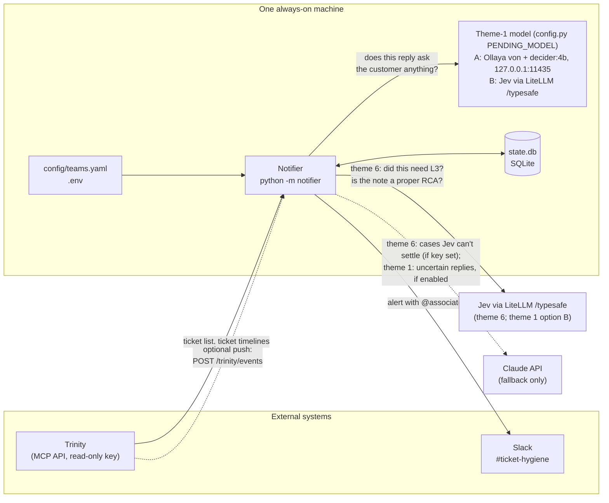

| Component | Role | Code |
|---|---|---|
| Trinity client | Lists changed tickets and reads timelines over Trinity's MCP endpoint (`list_tickets`, `get_ticket`, `get_ticket_messages`). It never writes. | `notifier/trinity.py` |
| Intake | Finds which tickets changed (polling, or push from Trinity) and reads only the events not seen before. | `notifier/service.py`, `notifier/webhook.py` |
| Theme checks | Pure functions over a ticket's ordered event list (themes 1–3, 6); themes 4–5 run on the clock. | `notifier/detectors.py`, `notifier/shift_checks.py` |
| Classifier | Theme 1: scores whether a reply asks the customer something. | `notifier/systemone.py` (option A or B), `notifier/classifier.py` (Claude) |
| Escalation judge | Theme 6a: Jev judges each escalation against the KB; Claude is the fallback (if `ANTHROPIC_API_KEY` is set). | `notifier/kb.py` |
| Team directory | Who is monitored, and who their associate is. | `notifier/teams.py`, `config/teams.yaml` |
| Slack | Builds and posts the alert; looks up associates' Slack IDs by email. | `notifier/slack.py` |
| State | Progress per ticket, scheduled checks, and sent alerts (prevents duplicates). | `notifier/store.py` |

---

## 2. End-to-end workflow

Every theme check goes through the same pipeline. The key idea: **a triggering event schedules a check for later instead of being judged on the spot**. Trinity timelines are not atomic. Engineers set PENDING before the reply lands, claims race within a second, and reassignments get undone. Waiting a few minutes and then re-reading the full timeline avoids judging a half-finished action.

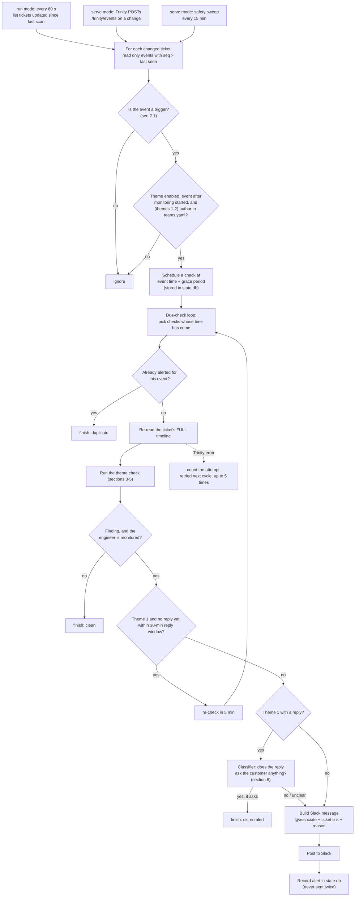

### 2.1 What counts as a trigger

| Trigger event in the timeline | Theme | Grace before checking |
|---|---|---|
| `status_changed` to PENDING **by a person** (Overwatch's own OPEN→PENDING is ignored) | 1 | 5 min first check, reply window 30 min |
| `assigned` where the author assigns to themselves a ticket held by another person | 2 | 5 min |
| `status_changed` to CLOSED **by System** (Overwatch close or 48 h inactivity auto-close) | 3 | 1 min |
| `level_changed` L1/L2 → L3 **by a person** (usually with tag `l3_needs_review`) | 6 | 10 min (lets the engineer's escalation note land) |

Themes 4 and 5 have no trigger event: they run on the clock (section 5b).

### 2.2 Run modes

| Mode | Command | How it learns about changes | When to use |
|---|---|---|---|
| Polling | `python -m notifier run` | Lists tickets updated in the last minute, every `POLL_SECONDS` | Today: Trinity does not push events yet |
| Event-driven | `python -m notifier serve` | Trinity POSTs to `/trinity/events`, plus a 15-minute safety sweep | Once the Trinity team adds the push hook (README: "What Trinity needs to send") |
| Backtest | `python -m notifier backtest --hours 24` | Replays recent history; prints alerts, never posts | Before go-live and after theme changes |
| Single ticket | `python -m notifier check <ticket_id>` | Explains every trigger on one ticket | When someone disputes an alert |

Both live modes share the same intake (`ingest_ticket`), state and due-check loop, so a ticket reported by both push and sweep is processed once.

---

## 3. Theme 1: moved to PENDING with no open question

SOP: PENDING is only for when we are waiting on the customer.

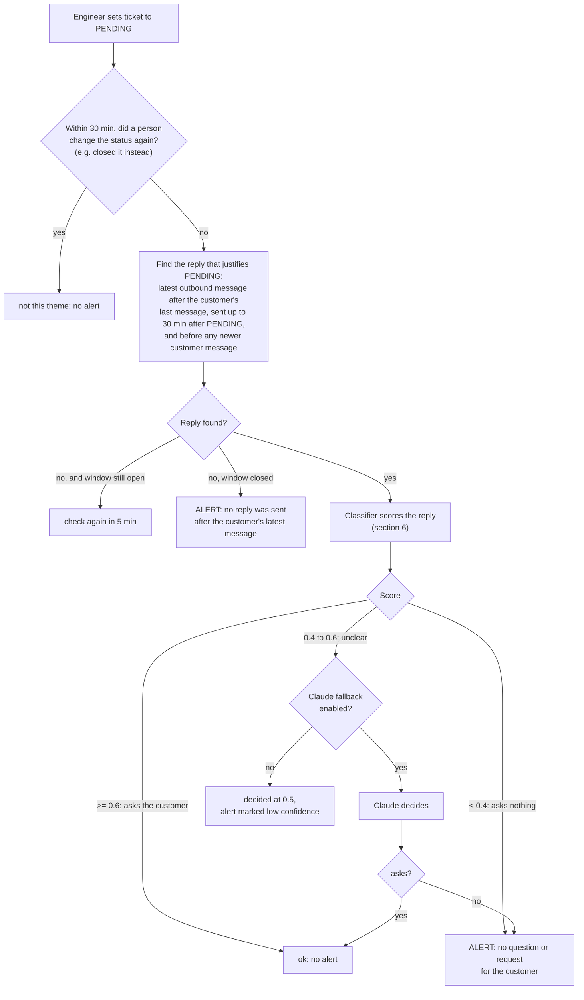

**Timing: two different waits.**

| Situation | When the decision is made | Why |
|---|---|---|
| A reply exists (the normal case) | **One check, 5 minutes after PENDING.** Asks the customer → no alert; asks nothing → alert. | Engineers sometimes set PENDING first and send the reply a minute or two later (#272717: PENDING 14:07, reply 14:09). Checking instantly would judge an older message instead of the reply that was actually sent. |
| No reply has been sent yet | Re-checked every 5 min. Alert "no reply was sent" only if there is still none **30 minutes** after PENDING. | #271615: PENDING at 09:51, reply (which did ask the customer something) at 09:58. An earlier check sent a false "no reply" alert. |

The 30 minutes is not a wait on every PENDING. It only applies while no reply exists. Both values are settings: `PENDING_GRACE_MINUTES` (5) and `PENDING_REPLY_WINDOW_MINUTES` (30).

---

## 4. Theme 2: ticket reassigned from a colleague

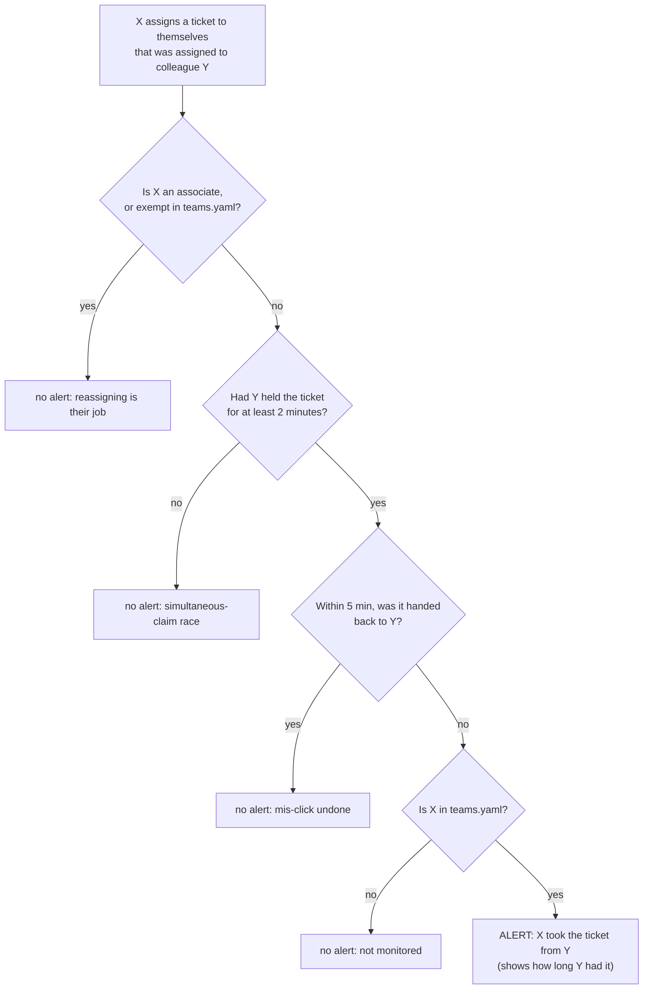

Why the 2-minute hold: on ticket #272874, four claims landed within 0.4 seconds after the owner freed the ticket. That is several people clicking "take" at once, not anyone taking over a colleague's work. Y can be anyone, monitored or not; only X must be in the list.

---

## 5. Theme 3: picked up while Overwatch was running, then closed by System

"Overwatch running" means an Overwatch run has started (`ai_triggered`) but has not produced anything yet: no auto-send, draft, escalation or completion.

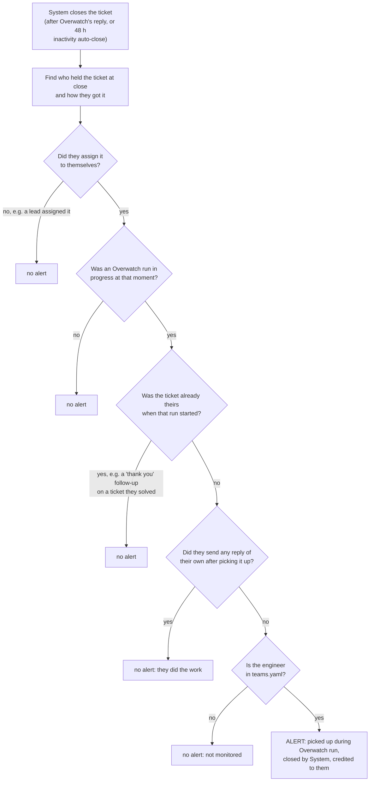

Closes by an engineer are never theme-3 triggers; only System closes are.

---

## 5b. Themes 4–6

### Shift schedule (themes 4 and 5)

Both themes read the team roster from `SHIFTS["file"]` in `config.py`: the roster sheet exported as `.csv` (or `.xlsx`). The roster has blocks per shift group, a header row `Agent, Email, Role, Fixed Weekly Off, 9-Oct : Fri, …`, and one row per person with that day's shift code in each date column.

- **Shift codes:** each cell is read individually (`6A-3P`, `11A-8P`, `9P-6A`, …), because people rotate between groups. Shifts ending after midnight run into the next day.
- **Days off:** `Off`, `EL` and `Comp Off`.
- **Unreadable cells:** cells like `swap(12th)` mark that person-day as unknown, and no checks run for it.
- **Dates:** the year is inferred from the weekday in the header.
- **Timezone:** times are in `SHIFTS["timezone"]` (IST).

The file is reloaded when it changes and at the start of each day. The notifier warns a week before the roster runs out, and lists monitored engineers missing from it (pending decision D6). A simpler one-row-per-shift format is also accepted (`config/shifts.example.csv`).

### Theme 4: Trinity status doesn't match shift

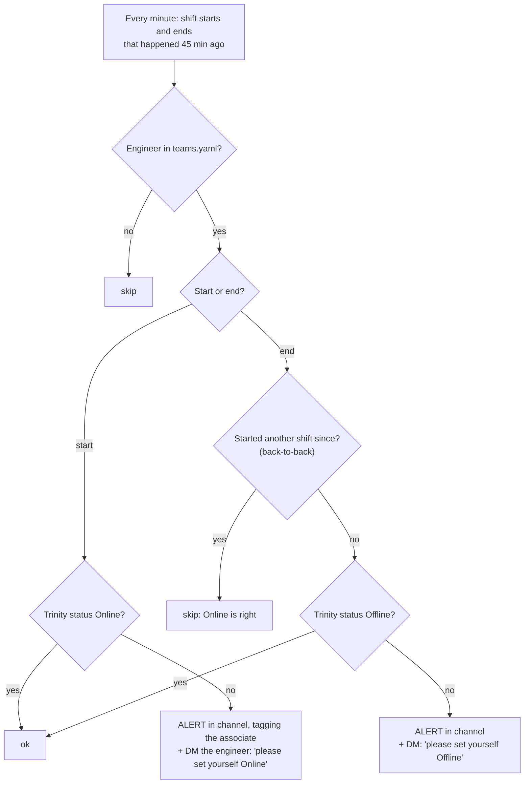

One alert per shift boundary. Status is Trinity's `presence` for the agent, read when the check runs.

### Theme 5: customer waiting on a ticket held by an off-shift engineer

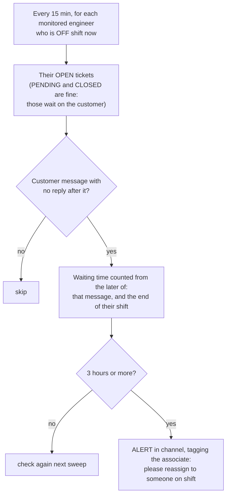

One alert per ticket per off-shift period. Counting from the shift end means engineers aren't blamed for waits that happened while they were working. The exact definition is pending decision D7.

### Theme 6: escalations to L3 (6a and 6b)

**What counts as an escalation.** A monitored engineer sets the level to L3, or adds `l3_needs_review` or `real_l3`. Events by the same engineer within 30 minutes count as one escalation. Both checks wait 15 minutes, because 93% of notes written after the move arrive within that time. If the same engineer takes the ticket back to L2 within the window, neither check fires.

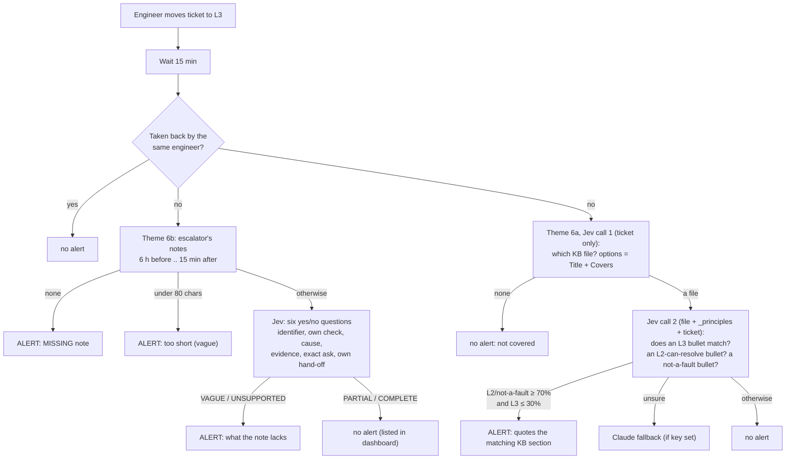

**How the KB was built** (`kb/escalation/`, layout in its README):
- **Notion research,** in `data/kb_research/notion_*.md`:
  - the escalation process;
  - the L1/L2/L3 permissions (51 rows);
  - the Escalation Matrix's note standard;
  - 216 support playbooks.
- **A corpus of 3,230 real escalations** (May to October 2026), pulled read-only by `scripts/escalation_corpus.py`. A fixed 1 in 5 tickets is held out for testing.
- **704 training cases** were judged by 8 analysts. For each case they gave a verdict and a note grade, and found the patterns. A 9th analyst defined the RCA standard.
- **9 writers** turned the analyses into 8 issue files plus `_principles.md` (shared by every judgement).
- **Contradictions with Notion** were resolved conservatively and recorded in `data/kb_research/conflicts_*.md` (pending decision D14).

**Measured on 146 held-out escalations** the KB never saw, with labels made independently and with hindsight (`scripts/eval_kb.py`):

| Check | Alerts that were right | Wrongly flagged | Caught |
|---|---|---|---|
| Theme 6a, first design (one "did this need L3?" question) | 26 of 83 | 57 of 75 genuine | 93% |
| **Theme 6a, built (three match questions)** | **3 of 3** | **0 of 90 genuine** | **10%** |
| **Theme 6b (note quality)** | **36 of 38** | **2 of 75 partial or complete notes** | **69%** |

Notes on the theme 6a results:
- **Why the first design failed:** the single question required evidence, in the conversation at escalation time, that L2 had tried the required steps. That evidence is rarely there, so Jev answered "no" almost always.
- **Why the built design is safe:** literal matching against KB bullets is what Jev does well.
- **Why it catches little:** unseen tickets rarely match a bullet confidently.
- **Status:** theme 6a stays off (pending decision D13). Theme 6b is on.

What the analyses found, across families:
- "Fixed by an L2-level account" is not evidence that L2 could have fixed it: several reviewers labelled L2 do L3-only work.
- A self-applied `real_l3` was genuine 56% of the time, against 78% when a reviewer applied it.
- A cause stated without evidence, and later refuted by L3, is the strongest single sign of a wrong escalation.
- Note quality does not predict whether L3 was needed. That is why themes 6a and 6b are separate.

The KB format is described in `kb/escalation/README.md`. L3's own verdicts (`real_l3` vs moved back to L2) can be used to measure the checker on real tickets before switching it on (pending decision D5).

---

## 6. Theme 1 classifier: does the reply ask the customer anything?

The model is chosen in `config.py` under `PENDING_MODEL`. Both options speak TypeSafe's `/v1/systemone` API, so one client (`notifier/systemone.py`) serves both.

- **Option A (default):** [Ollaya](https://github.com/ollaya-dev/ollaya), a local runtime for "decision models". The model is picked per reply by language:
  - English: `von` (ModernBERT-large, English-only), about 1–2 s per reply on a CPU.
  - Everything else: `decider:4b` (Qwen3.5-4B, multilingual), about 7–30 s per reply.

  Both are Apache-2.0, and customer text stays on the machine.
- **Option B:** Jev (`jev-latest`) through Emergent's LiteLLM (`https://litellm.central-infra-apps.emergentagent.com/typesafe`), one call per reply in every language, about 1 s. It needs `JEV_API_KEY` in `.env`, and customer text is sent to that service.

`research.md` covers the research behind both options.

The flowchart shows option A. Option B takes the "other" path for every reply, with `jev-latest` in place of `decider:4b`.

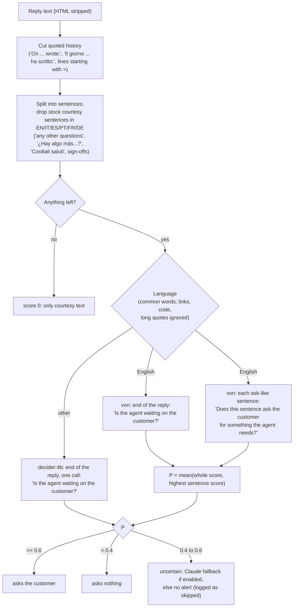

**Why both scores for `von`:** scoring the whole reply misses an ask buried mid-email, while scoring sentences alone is fooled by courtesy questions. **Why one call for `decider:4b`:** a multilingual LLM reads the whole reply well, and each extra call costs it seconds.

On 100 hand-written replies (`scripts/eval_classifier.py --option A|B --set all`: 36 English, 12 of them never used for tuning, and 64 in other languages):

| Option | Decided correct | Wrong alerts | Uncertain (no alert) | Time per reply |
|---|---|---|---|---|
| A: `von` + `decider:4b` | 95/97 | 2 (both new English cases) | 3 | ~1 s English, ~7 s other |
| B: Jev | **100/100** | 0 | 0 | ~1 s |

Which option to run in production is pending decision D9. `CLASSIFIER_BACKEND=claude` replaces both with Claude for every reply.

---

## 7. Example: one Pending check, end to end

```mermaid
sequenceDiagram
    autonumber
    participant E as Engineer
    participant T as Trinity
    participant N as Notifier
    participant O as Theme-1 model (option A/B)
    participant S as Slack

    E->>T: Sets ticket to PENDING (09:51)
    N->>T: Poll: tickets updated since last scan
    T-->>N: ticket list
    N->>T: Read new timeline events
    T-->>N: status_changed OPEN→PENDING by engineer
    Note over N: trigger → check scheduled for 09:56
    E->>T: Sends reply (09:58)
    N->>T: 09:56 check: read full timeline
    T-->>N: no reply yet
    Note over N: within 30-min window → re-check at 10:01
    N->>T: 10:01 check: read full timeline
    T-->>N: reply found (09:58)
    N->>O: POST /v1/systemone (whole reply + each sentence)
    O-->>N: P = 0.31 (asks nothing)
    N->>S: users.lookupByEmail(associate) → @mention
    N->>S: chat.postMessage(alert)
    Note over N: alert recorded; never sent twice
```

---

## 8. The Slack alert

```
⏳ Moved to Pending with no open question for the customer
Ticket:    #123456 · Uploads replace older documents     (link to Trinity)
Engineer:  Jane Doe (jane.doe@emergent.sh)
Associate: @Team Lead
Why flagged: No question or request for the customer found in the reply (von: 38% …)
Reply that was judged (end of message):
> … Allowing several files per type would be a new feature. We can pass this on as a request.
```

Theme 2 alerts add "Taken from: Y (they had it for 36 h)". Theme 3 alerts add "Closed by: System auto-close after 48h of inactivity" or "System, right after Overwatch's reply".

---

## 9. State and reliability

`state.db` (SQLite) holds:

| Table | Holds | Why |
|---|---|---|
| `kv` | Last scan time, monitoring start time | Resume after restart without rescanning history |
| `ticket_progress` | Highest event `seq` seen per ticket | Read only new events |
| `checks` | One row per (theme, trigger event): due time, attempts, outcome | Delayed evaluation, theme-1 re-checks, retries |
| `alerts` | One row per alert sent, with ticket number, subject, reason, associates tagged, link, and whether it was a dry run | Guarantees no alert is ever sent twice; the dashboard's alert list |
| `activity` | Append-only trace of everything the notifier does: start, poll cycle, check scheduled, recheck, model call (model, probability, language, latency, the reply judged), alert sent, check outcome, status check, off-shift sweep, error | The dashboard's live feed, river and per-alert trace |
| `feedback` | Associates' verdicts on alerts (correct or false alarm, note, who, when), never overwritten | Labelled data for measuring the models (D1, D9) |
| `dashboard_sessions` | Signed-in dashboard sessions (token hash, email, expiry) | Sign-in gate |

The notifier writes `kv` "heartbeat" whenever it works (at least every 15 s while busy, and after every cycle), so the dashboard can tell "running" from "stopped". SQLite runs in WAL mode, so the dashboard reads while the notifier writes. Writing the trace can never break a check: a trace write failure is logged and the check carries on.

| Situation | Behaviour |
|---|---|
| Restart | Picks up from the stored scan time; due checks still run; sent alerts are not repeated. |
| Trinity error | Poll cycle retried next interval; a failing check is retried up to 5 times. |
| Theme-1 model down (Ollaya not running, or Jev unreachable / key rejected) | Claude fallback if enabled; otherwise the Pending check is skipped and logged as an error (no alert, so associates aren't flooded). The notifier also checks the chosen option at startup and says what to fix. For option A, start Ollaya with `scripts\ollaya.ps1 start`. |
| Duplicate push or sweep overlap | Harmless: progress is tracked by event seq, and checks are keyed by event id. |
| Two notifier instances | Not supported: they would double-post. Run exactly one. |

---

## 9b. The dashboard (observability)

`python -m dashboard` serves a web UI for associates, on port 8090 by default. It reads the same `state.db`. It is read-only on Trinity and on the notifier; its only writes are feedback on alerts and sign-in sessions.

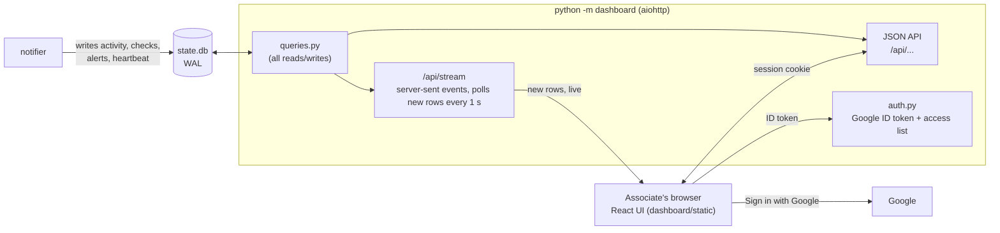

**Sign-in:**
1. The browser gets a signed ID token from Google.
2. The server checks the signature, the audience (`GOOGLE_CLIENT_ID`), the issuer, and that the email is verified.
3. It then checks the email against `config/dashboard_users.yaml` and issues a session: a random token in an HttpOnly, SameSite=Lax cookie, stored only as a hash, valid for 12 h.
4. Every request re-checks the access list, so removing an email ends that person's access immediately.
5. POSTs must carry `X-Requested-With: dashboard`, which blocks forged cross-site form posts.
6. A strict Content-Security-Policy allows only the app itself and Google's sign-in script.

**Live updates:**
- One `EventSource` per browser.
- The server sends each new `activity` row as it lands, and the notifier's status every 10 s.
- The browser resumes from the last event id after a disconnect, so nothing is missed.

**Views:**

| Route | Shows |
|---|---|
| `/` Live | The river: the last hour's checks as lights in their theme's lane, with alerts as red streaks (click opens the ticket). Then your team's unreviewed alerts, themes with 12-hour activity, notifier health, and the live feed (Decisions / Everything). |
| `/alerts`, `/alerts/:id` | Every alert, filterable by theme, review state, time and search. One alert's detail shows the reason, the reply judged with the model's score on the 40/60 scale, the Slack message, the full trace, and the verdict box. |
| `/review` | Review queue: unreviewed alerts one at a time, with the next one preloaded. Keys: J/K to move, C for correct, F for false alarm. |
| `/team` | Per engineer: alerts by theme, false alarms, checks, last activity. |
| `/tickets/:ref` | Everything recorded for one ticket, by number or id. |
| `/system` | Running state, configuration, model latency (p50/p95), check outcomes, recent errors. |

**Team scope:** associates see every team. Their own team is selected by default, and it is one click to "All teams".

**Design:** the "Long Exposure" direction, made with the Impeccable skill.
- `PRODUCT.md` holds the product brief.
- `.impeccable/surfaces/dashboard-web-index-html.md` holds the direction contract.
- The idea: the notifier's live traffic, seen through frosted glass. Red is reserved for alerts.
- Dark and light modes come from the same tokens, with a switch in the top bar.

**Before deploying beyond this laptop** (pending decision D10): Google sign-in needs https for any address other than `localhost`.

---

## 10. Deployment and security

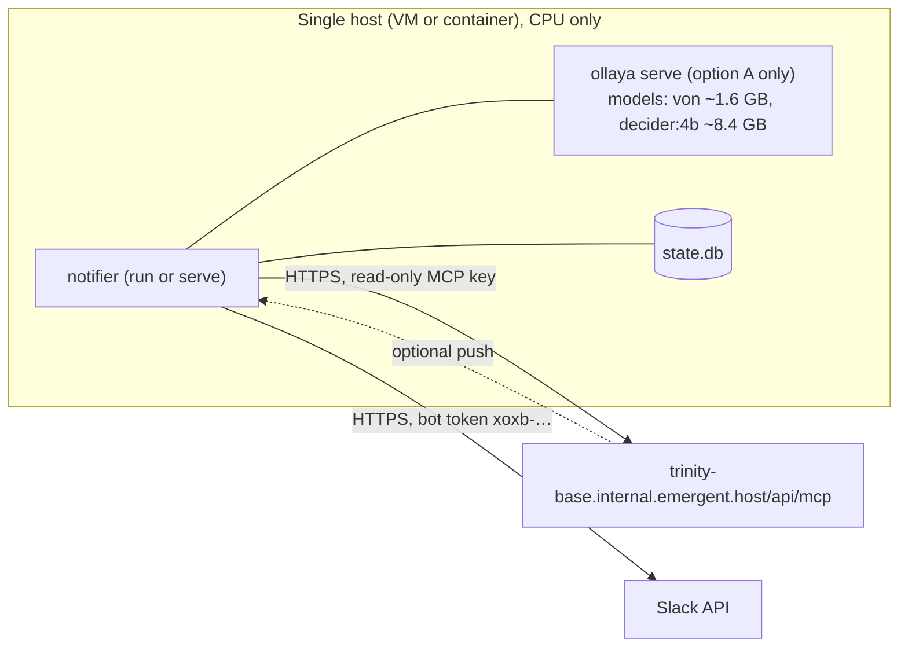

- **Trinity:** a read-only MCP key (`readOnlyKey: true`). The notifier only reads.
- **Slack:** bot scopes `chat:write`, `users:read`, `users:read.email`, and `im:write` (theme-4 reminders by DM) only (`config/slack-app-manifest.yaml`).
- **Customer data:** with option A, reply text goes only to the local Ollaya process. With option B it is sent to Jev through Emergent's LiteLLM. Theme 6 sends escalation notes (6b) and, once 6a is on, the escalated ticket's conversation to Jev, and to Claude when Jev can't settle it (only if `ANTHROPIC_API_KEY` is set). The optional theme-1 Claude fallback also sends text to Claude.
- **Secrets:** in `.env`, which is git-ignored, as are `config/teams.yaml`, `config/dashboard_users.yaml`, `state.db` and `.tools/` (Ollaya binaries and models).
- **Dashboard:** Google sign-in on an access list; sessions hashed server-side; HttpOnly cookies; CSRF header on POSTs; strict CSP. It shows customer reply text inside alert traces, but only to signed-in associates. The local test sign-in (`DASHBOARD_DEV_LOGIN`) works only from 127.0.0.1 while the server listens on 127.0.0.1.

---

## 11. Configuration reference (defaults)

| Setting | Default | Meaning |
|---|---|---|
| `POLL_SECONDS` | 60 | Polling interval (`run` mode) |
| `RECONCILE_MINUTES` | 15 | Safety sweep interval (`serve` mode) |
| `PENDING_GRACE_MINUTES` | 5 | First theme-1 check after PENDING |
| `PENDING_REPLY_WINDOW_MINUTES` | 30 | How long a reply after PENDING still counts |
| `REASSIGN_GRACE_MINUTES` | 5 | Wait for a hand-back before judging theme 2 |
| `REASSIGN_MIN_HOLD_MINUTES` | 2 | Colleague must have held the ticket at least this long |
| `CLOSE_GRACE_MINUTES` | 1 | Wait before judging theme 3 |
| `CLASSIFIER_BACKEND` | `systemone` | `systemone` (Ollaya / Jev-compatible) or `claude` |
| `JEV_API_KEY` | (empty) | Jev key, needed only for `PENDING_MODEL` option B in `config.py` |
| `SYSTEMONE_LOW` / `SYSTEMONE_HIGH` | 0.4 / 0.6 | Uncertain band |
| `SYSTEMONE_FALLBACK` | `none` | `claude` sends only uncertain replies to Claude |
| `DRY_RUN` | `true` | Print alerts instead of posting |

The full list is in `.env.example`.

**`config.py` (project root)** switches the 6 themes on and off and holds their main settings:

| Setting | Default | Meaning |
|---|---|---|
| `THEMES` | 1–5 and 6b on, 6a off | One switch per theme check (6a and 6b are separate) |
| `SHIFTS["file"]` / `["timezone"]` | `config/shifts.xlsx` / `Asia/Kolkata` | Shift schedule for themes 4–5 |
| `STATUS_CHECK["minutes_after_shift_boundary"]` | 45 | When theme 4 checks the status |
| `STATUS_CHECK["post_to_channel"]` / `["dm_engineer"]` | true / true | Where theme 4 alerts go |
| `OFF_SHIFT_HOLDING["customer_waiting_hours"]` | 3 | Theme 5 threshold |
| `OFF_SHIFT_HOLDING["sweep_minutes"]` | 15 | How often theme 5 checks |
| `L3_ESCALATION["kb_dir"]` | `kb/escalation` | Knowledge base for theme 6a |
| `L3_ESCALATION["judge_model"]` | `jev-latest` | Jev model that judges escalations (at `JEV_URL`, key `JEV_API_KEY`) |
| `L3_ESCALATION["fallback_model"]` | `claude-opus-5-5` | Claude model for cases Jev can't settle (`None` = never use Claude). Needs `ANTHROPIC_API_KEY`; without it the fallback is off with a warning, no error |
| `L3_ESCALATION["min_confidence"]` | `medium` | Theme 6a only alerts at or above this confidence |

---

## 12. Testing before go-live

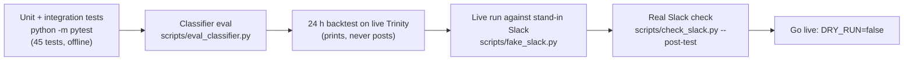

`scripts/fake_slack.py` is a local stand-in for the Slack API. It enforces the same rules as Slack: valid token, bot must be in the channel, message size limits, and user lookup by email. That lets the whole workflow be tested end to end before the Slack app is approved.
